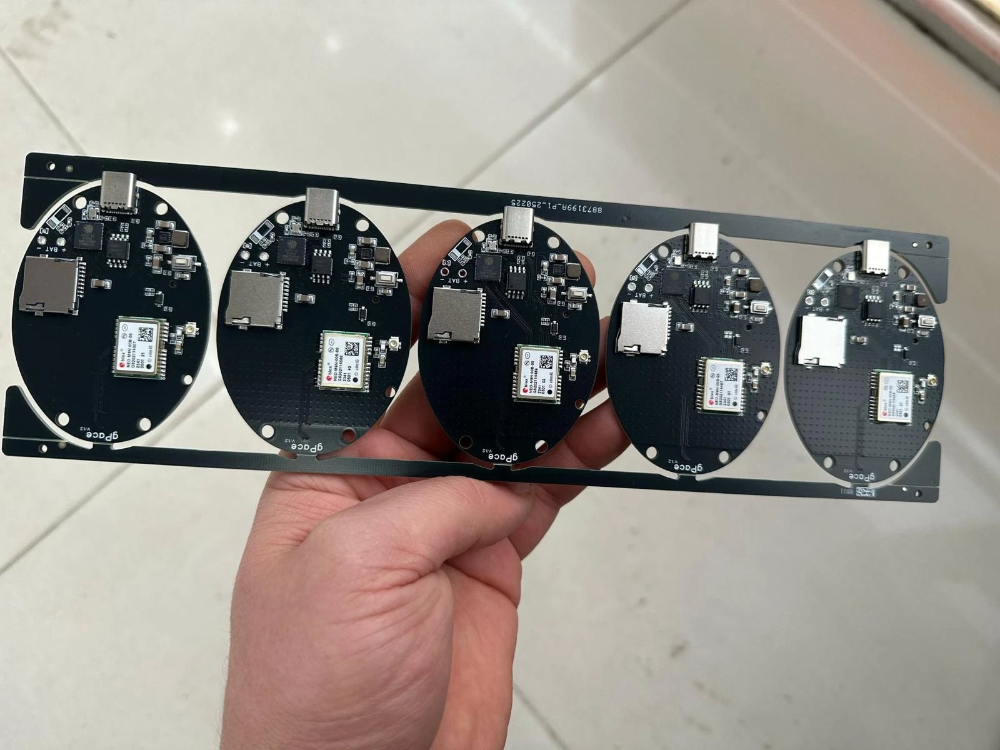
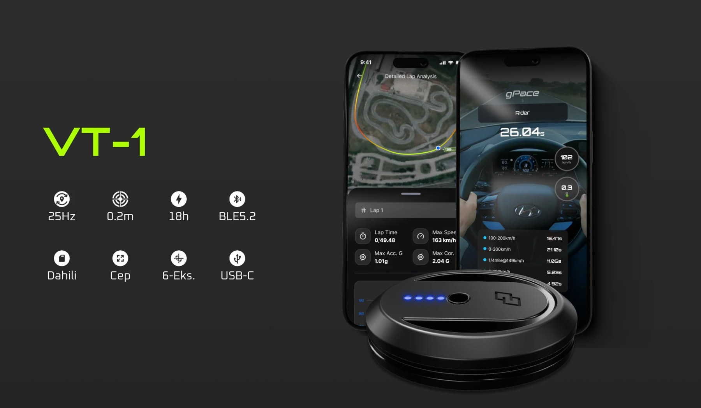
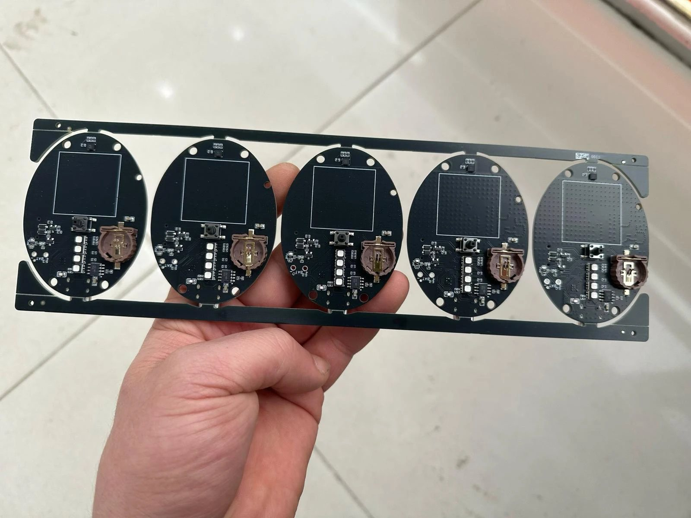
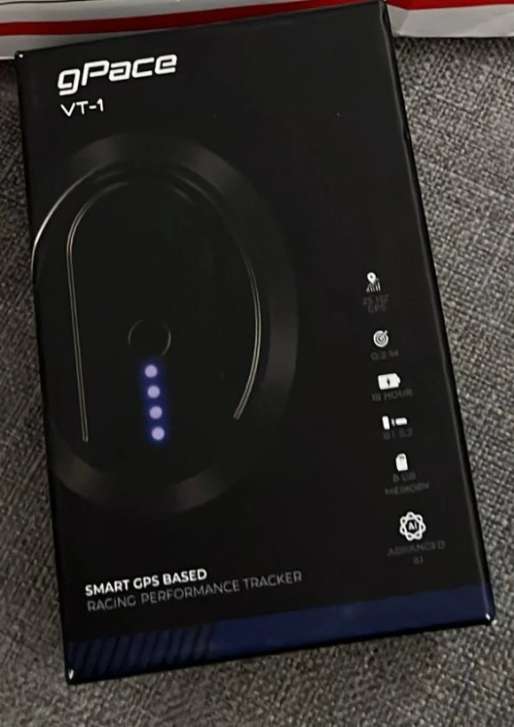
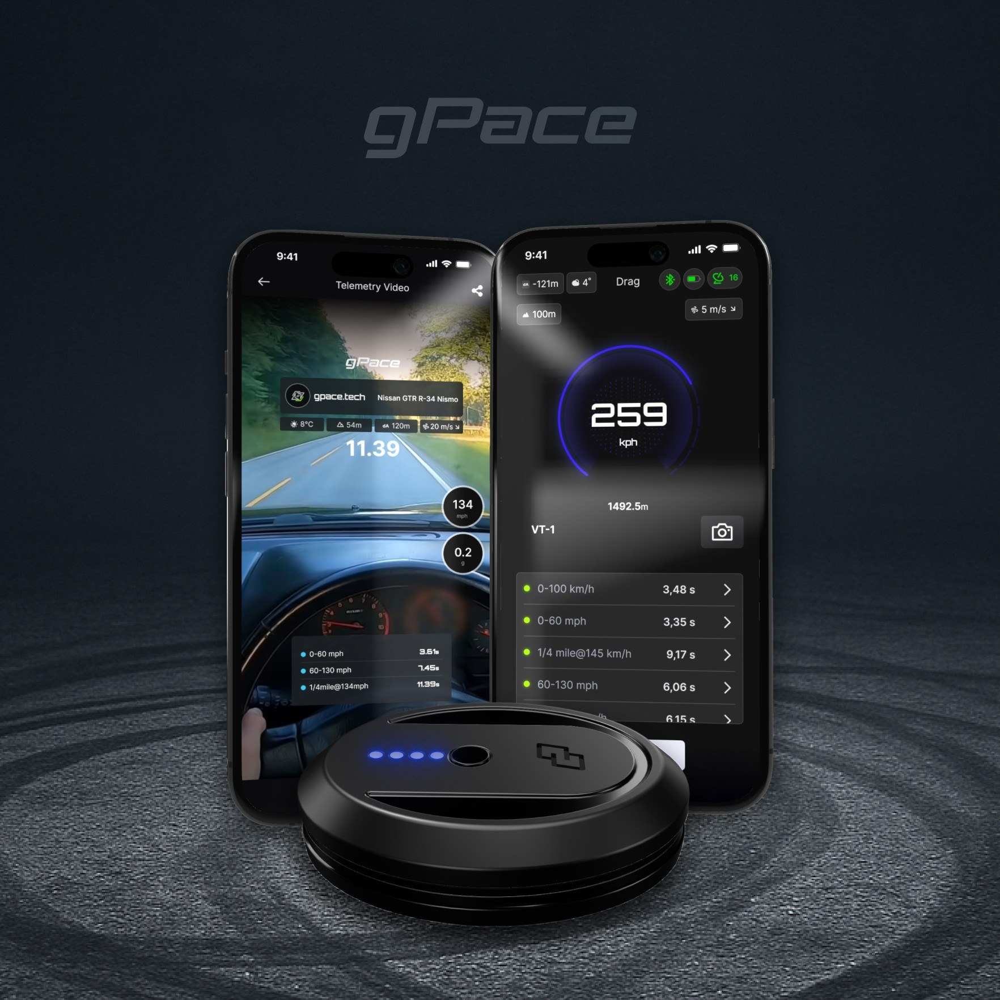
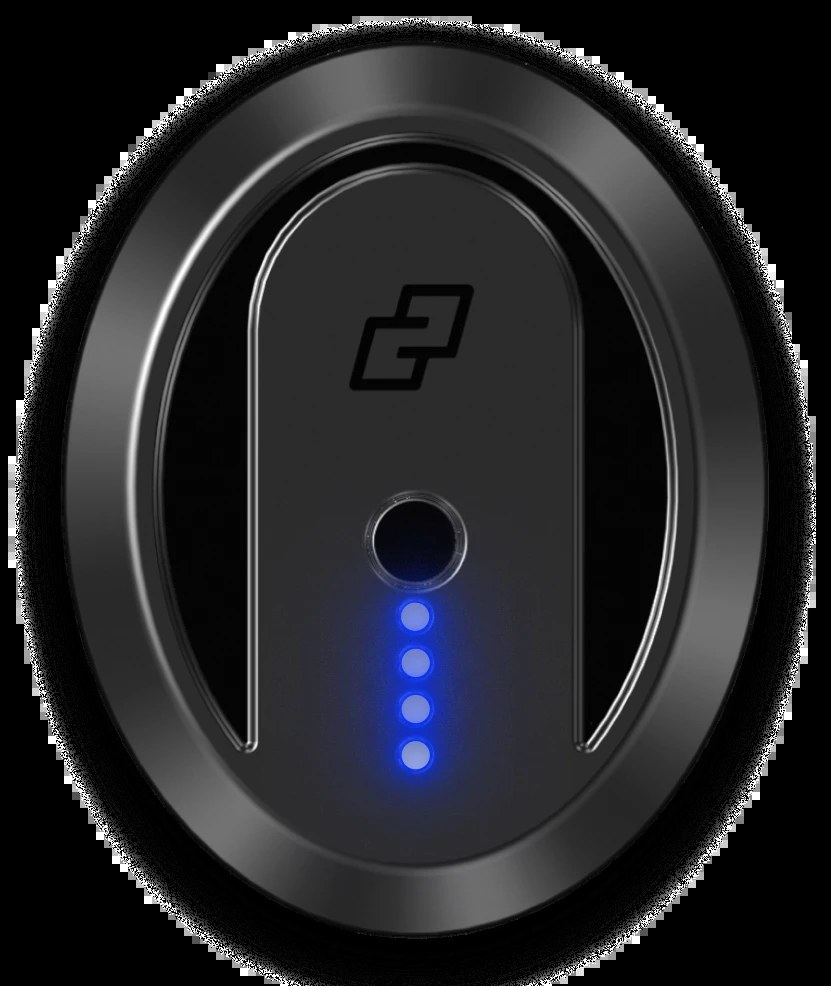
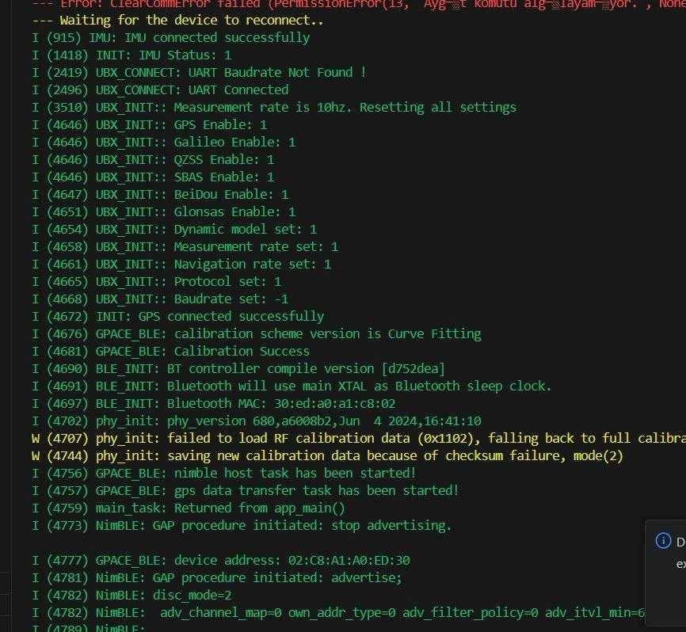

# gPace VT-1: smart GPS racing performance tracker

**Role: Co-Founder | Embedded Development & Design** · Jun 2023 to Jan 2026

> 🇹🇷 **Özet:** gPace VT-1, pist ve yarış sürüşü için geliştirdiğimiz akıllı GPS performans takip cihazı. Projede donanım tarafının tamamından ve ürünün fiziksel operasyonundan sorumluydum: donanım çizimi, komponent seçimi, tedarik, stok takibi, montaj, yazılım yükleme ve uçak kargo ile gönderim. Firmware'i Emir Demirhan ile birlikte geliştirdik.

## My role in the project

I owned the hardware side of gPace from the first prototype to delivered customer units, and ran the physical operations behind it.

| Area | Responsibility |
|---|---|
| **Hardware design** | Schematic and PCB design (EasyEDA), board revisions up to v1.2, design for manufacturing |
| **Component selection** | Chose and validated parts for GNSS, motion sensing, controller, storage, charging and power; weighed performance, availability and cost |
| **Procurement and supply chain** | Sourced components and circuit boards, managed suppliers and lead times, handled import of parts |
| **Inventory and stock tracking** | Kept stock records for components, boards and finished units; planned reorders against production needs |
| **Assembly** | Organized and carried out assembly of prototypes and production units |
| **Firmware development** | Co-developed the firmware with Emir Demirhan, including our own u-blox and Bosch BMI270 drivers |
| **Firmware loading** | Loaded firmware onto production units |
| **Logistics** | Packed units and prepared air-freight international shipments |
| **Product and production** | Enclosure and injection-mold preparation, retail packaging, collaboration with a US maker of racing camera mounts |

**Product:** compact data logger for track and race driving, streaming position, speed and motion data to a phone over Bluetooth LE.

**Links:** [Website](https://gpaceapp.wixstudio.com/gpace) · [Instagram](https://www.instagram.com/gpace.tech) · [Collaboration video](https://youtu.be/yfP_QW0Hz6A)

## The product

VT-1 is a small, oval, battery-powered tracker. It reads a high-rate GNSS fix and inertial motion data, packs them into one compact frame and streams it to a phone app over Bluetooth LE, while keeping its own memory card for logging. It was taken from first prototype to a production-ready design with injection-molded housing and retail packaging.

| Stage | What it looked like |
|---|---|
| **First prototype** (green PCB, ceramic patch antenna, LiPo, LED bar) |   |
| **v1.2 production PCB** (black, antenna connector, SD card, USB-C) |   |
| **Housing and retail box** |    |

## The app

The VT-1 pairs with the gPace phone app (lap analysis, drag and acceleration timing, telemetry video overlay). Follow the project on [Instagram](https://www.instagram.com/gpace.tech) and [the website](https://gpaceapp.wixstudio.com/gpace).

 

## Hardware (v1.2)

Schematic: [`hardware/SCH_GPACE_V1.2_2024-12-14.pdf`](hardware/SCH_GPACE_V1.2_2024-12-14.pdf) (EasyEDA, dated 2024-12-14, board manufactured by JLCPCB).

| Block | Parts |
|---|---|
| **Main controller** | Espressif ESP32-S3R8 (Wi-Fi and Bluetooth LE SoC), 40 MHz clock, 256 Mbit external flash (Winbond W25Q256JV), 2.4 GHz chip antenna |
| **GNSS** | u-blox NEO-M9N with U.FL connector for an external or on-board patch antenna, CR1220 backup cell for fast re-acquisition, PPS output to an LED |
| **Motion** | Bosch BMI270 6-axis IMU on the I2C bus |
| **Storage** | microSD card slot (4-bit interface) |
| **Power** | USB-C input, TP4056 single-cell Li-ion charger, 1000 mAh LiPo, battery-voltage divider into the ADC, TPS63030 buck-boost regulator to 3.3 V, resettable fuse |
| **Power button** | Soft-latch circuit: a MOSFET keeps the supply on until the firmware releases it, so shutdown is under software control |
| **Indicators** | Four RGB LEDs (power, status, Bluetooth, GNSS PPS) |

PCB layout (3D view):

## Firmware

ESP-IDF (C) with the NimBLE Bluetooth LE stack. Developed together with **Emir Demirhan** (the v1 repository was committed under his account). Two generations are in this repository:

| | Folder | What it is |
|---|---|---|
| **v1** | [`firmware/`](firmware) | the firmware as it ran on the products, snapshot unchanged |
| **v2** | [`firmware-v2/`](firmware-v2) | a ground-up rework with a tested core, described below |

### Our own drivers

The two sensor drivers were the biggest engineering effort in the firmware, and both were written by us rather than taken from a vendor library:

- **u-blox NEO-M9N driver:** speaks the receiver's binary protocol directly. Finds the link speed, writes the configuration keys (GPS, Galileo, BeiDou, GLONASS, QZSS, SBAS, dynamic model, 25 Hz rate, output messages, baud), parses position-velocity-time messages and verifies every checksum.
- **Bosch BMI270 driver:** brings the IMU up from reset, uploads the 8 KB configuration image, verifies the init status, reads acceleration and angular rate in one burst and applies the gyro cross-axis correction.

### Firmware v2

v2 is the project as I would build it knowing what v1 taught us.

- **Portable core, thin hardware layer.** Drivers talk to small function tables instead of the chip, so the same code runs against a **fake GNSS receiver and a fake BMI270** on a laptop. 706 automated checks, built with strict warnings and sanitizers.
- **Better drivers.** Byte-wise parser with checksum verification and resync, key sizes derived from the key ID, rejected keys reported, automatic output with polling fallback, one burst read per IMU sample and no heap use in the data path.
- **Same bytes on the wire.** The 57-byte frame is proven byte-identical to the v1 packer over 500 random inputs, so existing phone apps keep working.
- **Defects fixed.** Everything found in the code review below, plus removal of sensor I/O from inside the Bluetooth callback.
- **Documented.** [Architecture](firmware-v2/docs/ARCHITECTURE.md), [protocol](firmware-v2/docs/PROTOCOL.md), [bring-up checklist](firmware-v2/docs/BRINGUP.md), [v1 to v2 changes](firmware-v2/docs/MIGRATION.md), [testing](firmware-v2/docs/TESTING.md).

**Status, stated plainly:** the portable core and its tests pass on a laptop. The ESP-IDF layer of v2 has not been compiled or run on a board, and a few register details are flagged for verification in the bring-up checklist. v1 is the code that shipped.

### What the firmware does (v1 and v2)

- **GNSS configuration and parsing** with all constellations enabled and a high update rate
- **IMU** acceleration and angular rate
- **Bluetooth LE GATT server:** custom data characteristic (read and notify), Device Information, Battery Level, and characteristics for over-the-air firmware transfer
- **Data frame:** 57 bytes carrying longitude, latitude, altitude, accuracy, speed, heading, DOP, satellite count, time, six IMU axes and fix type
- **Battery measurement** through a calibrated ADC and voltage divider
- **Power management:** soft-latch shutdown on button press with LED sequence
- **Fault handling:** start-up retries, error LED, restart on sustained failure

<table><tr>
<td></td>
<td></td>
</tr><tr>
<td align="center">Boot log: sensor start-up, GNSS configuration, Bluetooth advertising</td>
<td align="center">Data notifications on the Bluetooth characteristic</td>
</tr></table>

### Code review

Reading v1 line by line I found three real defects (wrong gyro axes, a mis-sized queue, a battery read that sends bytes past its variable). Details in [`firmware-review/REVIEW.md`](firmware-review/REVIEW.md); a patch for the first two is in [`fixes.patch`](firmware-review/fixes.patch). **The patch has not been compiled or tried on a board.**

## Skills demonstrated

Embedded product development from prototype to production · schematic and PCB design (EasyEDA, JLCPCB manufacturing) · component selection and procurement · inventory and stock control · assembly and production coordination · international air-freight logistics · GNSS and IMU sensor integration · writing sensor drivers from datasheets · Bluetooth LE GATT and data-frame design · ESP-IDF firmware · host-side unit testing with simulated hardware · battery, charging and soft-power design · enclosure and injection-mold preparation · partner collaboration · code review and documentation

---

*Product and brand names belong to their owners. Components and logos mentioned belong to Espressif, u-blox, Bosch, Winbond, Texas Instruments and others. © gPace Tech.*
