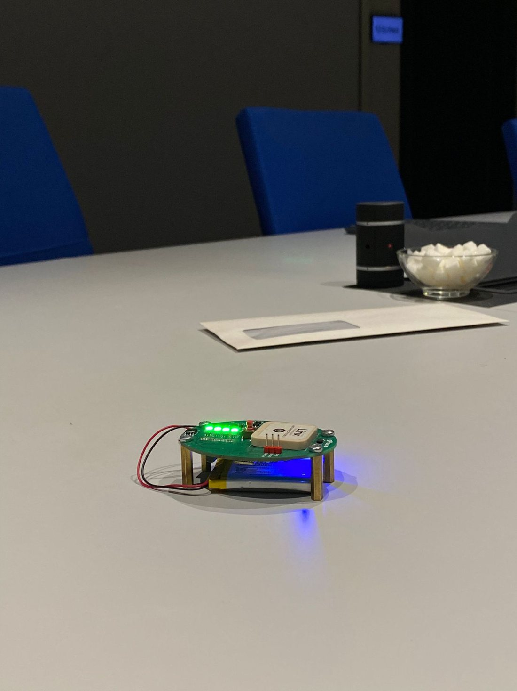
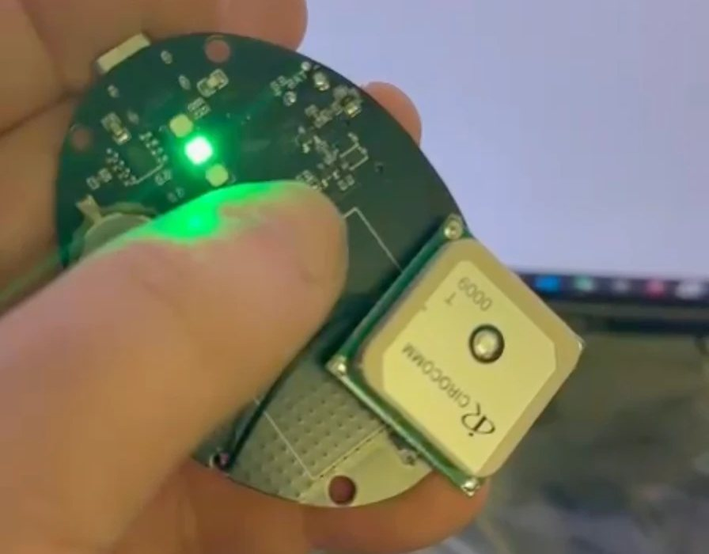
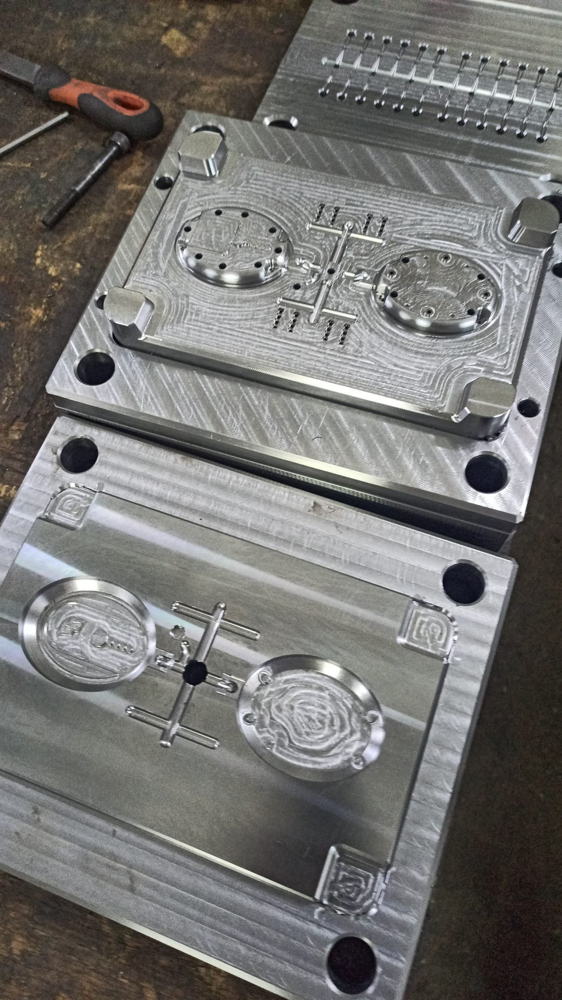
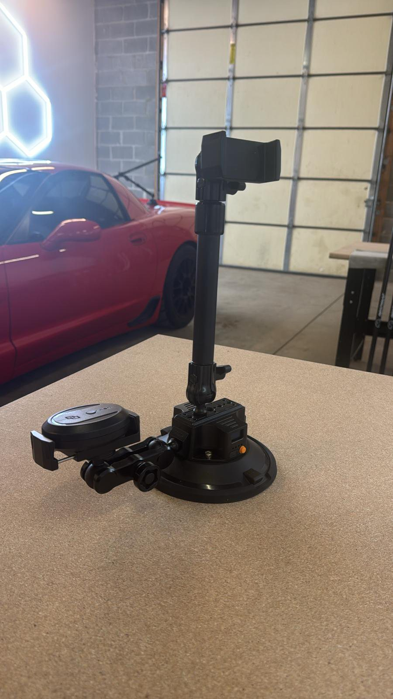
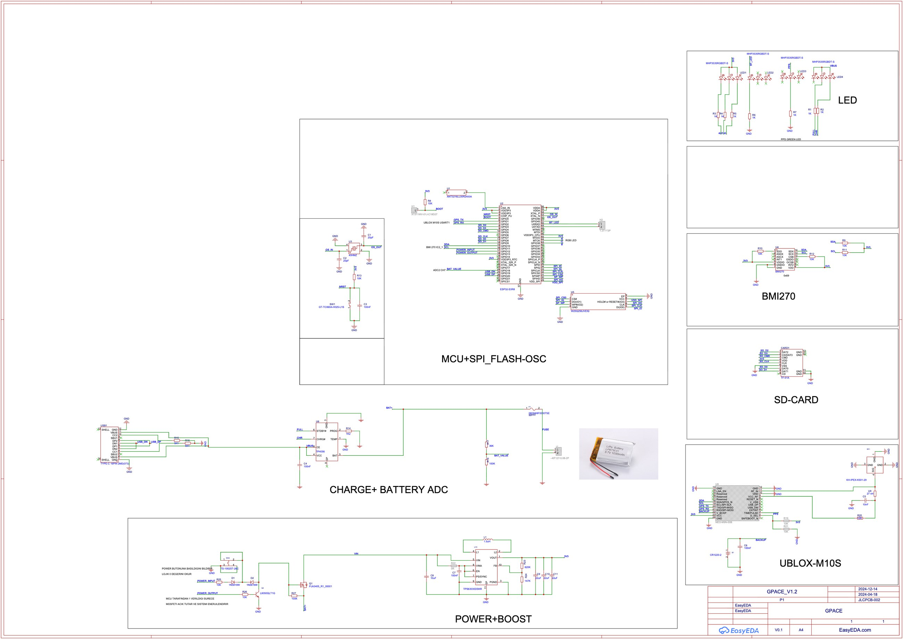
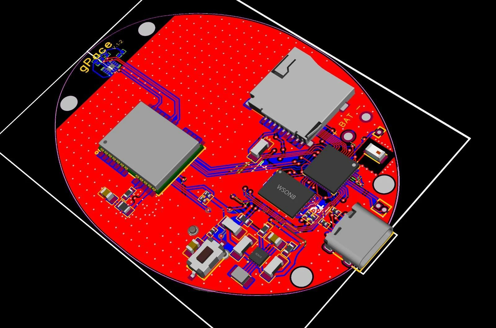
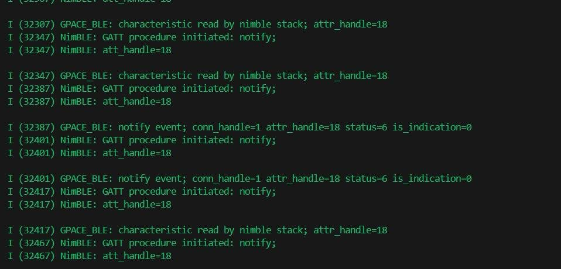

# gPace VT-1: smart GPS racing performance tracker

**Role: Co-Founder | Embedded Development & Design** · Jun 2023 to Jan 2026

> 🇹🇷 **Özet:** gPace VT-1, pist ve yarış sürüşü için geliştirdiğimiz akıllı GPS performans takip cihazı. Projede donanım tarafının tamamından ve ürünün fiziksel operasyonundan sorumluydum: donanım çizimi, komponent seçimi, tedarik, stok takibi, montaj, yazılım yükleme ve uçak kargo ile gönderim. Firmware'i Emir Demirhan ile birlikte geliştirdik.

## My role in the project

I owned the hardware side of gPace from the first prototype to delivered customer units, and ran the physical operations behind it.

| Area | Responsibility |
|---|---|
| **Hardware design** | Schematic and PCB design (EasyEDA), board revisions up to v1.2, design for manufacturing |
| **Component selection** | Chose and validated parts for GNSS, motion sensing, controller, storage, charging and power; weighed performance, availability and cost |
| **Procurement and supply chain** | Sourced components and circuit boards, managed suppliers and lead times, handled import of parts |
| **Inventory and stock tracking** | Kept stock records for components, boards and finished units; planned reorders against production needs |
| **Assembly** | Organized and carried out assembly of prototypes and production units |
| **Firmware development** | Co-developed the firmware with Emir Demirhan, including our own u-blox and Bosch BMI270 drivers |
| **Firmware loading** | Loaded firmware onto production units |
| **Logistics** | Packed units and prepared air-freight international shipments |
| **Product and production** | Enclosure and injection-mold preparation, retail packaging, collaboration with a US maker of racing camera mounts |

**Product:** compact data logger for track and race driving, streaming position, speed and motion data to a phone over Bluetooth LE.

**Links:** [Website](https://gpaceapp.wixstudio.com/gpace) · [Instagram](https://www.instagram.com/gpace.tech) · [Collaboration video](https://youtu.be/yfP_QW0Hz6A)

## The product

VT-1 is a small, oval, battery-powered tracker. It reads a high-rate GNSS fix and inertial motion data, packs them into one compact frame and streams it to a phone app over Bluetooth LE, while keeping its own memory card for logging. It was taken from first prototype to a production-ready design with injection-molded housing and retail packaging.

| Stage | What it looked like |
|---|---|
| **First prototype** (green PCB, ceramic patch antenna, LiPo, LED bar) |   |
| **v1.2 production PCB** (black, antenna connector, SD card, USB-C) |   |
| **Housing and retail box** |    |

## Hardware (v1.2)

Schematic: [`hardware/SCH_GPACE_V1.2_2024-12-14.pdf`](hardware/SCH_GPACE_V1.2_2024-12-14.pdf) (EasyEDA, dated 2024-12-14, board manufactured by JLCPCB).

| Block | Parts |
|---|---|
| **Main controller** | Espressif ESP32-S3R8 (Wi-Fi and Bluetooth LE SoC), 40 MHz clock, 256 Mbit external flash (Winbond W25Q256JV), 2.4 GHz chip antenna |
| **GNSS** | u-blox NEO-M9N with U.FL connector for an external or on-board patch antenna, CR1220 backup cell for fast re-acquisition, PPS output to an LED |
| **Motion** | Bosch BMI270 6-axis IMU on the I2C bus |
| **Storage** | microSD card slot (4-bit interface) |
| **Power** | USB-C input, TP4056 single-cell Li-ion charger, 1000 mAh LiPo, battery-voltage divider into the ADC, TPS63030 buck-boost regulator to 3.3 V, resettable fuse |
| **Power button** | Soft-latch circuit: a MOSFET keeps the supply on until the firmware releases it, so shutdown is under software control |
| **Indicators** | Four RGB LEDs (power, status, Bluetooth, GNSS PPS) |

PCB layout (3D view):

## Firmware

ESP-IDF (C) with the NimBLE Bluetooth LE stack. Developed together with **Emir Demirhan** (the repository was committed under his account). Source snapshot in [`firmware/`](firmware).

- **GNSS configuration and parsing:** on boot the firmware finds the receiver's link speed, enables GPS, Galileo, BeiDou, GLONASS, QZSS and SBAS, sets the dynamic model, measurement and navigation rates and the protocol, then reads position-velocity-time messages from the u-blox binary protocol
- **IMU:** loads the BMI270 configuration and reads acceleration and angular rate
- **Bluetooth LE GATT server:** custom data characteristic (read and notify), Device Information (manufacturer, model, serial, firmware version), Battery Level, and characteristics for over-the-air firmware transfer
- **Data frame:** one 55-byte frame plus checksum carrying longitude, latitude, altitude (ellipsoid and sea level), horizontal accuracy, speed, heading, speed accuracy, PDOP, satellite count, time, six IMU axes and fix type, notified roughly every 10 ms
- **Battery measurement:** calibrated ADC reads through the voltage divider
- **Power management:** button interrupt, queue and task that turn the latch MOSFET off after a short LED sequence
- **Fault handling:** retries for GNSS and IMU start-up, an error LED task, and a restart if initialization keeps failing

<table><tr>
<td></td>
<td></td>
</tr><tr>
<td align="center">Boot log: sensor start-up, GNSS configuration, Bluetooth advertising</td>
<td align="center">Data notifications on the Bluetooth characteristic</td>
</tr></table>

### Code review

While documenting the code I found two real defects and prepared a patch without touching the original snapshot. Details in [`firmware-review/REVIEW.md`](firmware-review/REVIEW.md); the patch is [`fixes.patch`](firmware-review/fixes.patch). **The patch has not been compiled or tried on a board.**

## Skills demonstrated

Embedded product development from prototype to production · schematic and PCB design (EasyEDA, JLCPCB manufacturing) · component selection and procurement · inventory and stock control · assembly and production coordination · international air-freight logistics · GNSS and IMU sensor integration · Bluetooth LE GATT and data-frame design · ESP-IDF firmware · battery, charging and soft-power design · enclosure and injection-mold preparation · partner collaboration · code review and documentation

---

*Product and brand names belong to their owners. Components and logos mentioned belong to Espressif, u-blox, Bosch, Winbond, Texas Instruments and others. © gPace Tech.*
